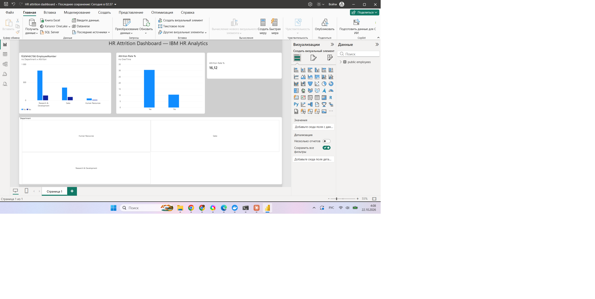

# HR Attrition Analysis — SQL & Power BI Dashboard

End-to-end analytics project using the IBM HR Analytics Employee Attrition dataset: data loaded into PostgreSQL, analyzed with advanced SQL (window functions, CTEs), and visualized in an interactive Power BI dashboard.

## Tech stack
- PostgreSQL (Docker)
- Python (pandas, SQLAlchemy, psycopg) — data loading via Jupyter Notebook
- SQL: GROUP BY, window functions (SUM/AVG/RANK OVER, PARTITION BY), CTEs, CASE WHEN
- Power BI Desktop (DAX measures, interactive dashboard)

## Key findings
- Overall attrition rate: **16.1%**
- By department: Sales 20.6%, HR 19.0%, R&D 13.8%
- Employees paid **below** their department's average income leave at nearly **2x** the rate of those paid above average (19.1% vs 9.9%)
- Employees working **overtime** leave at nearly **3x** the rate of those who don't (30.5% vs 10.4%)
- Top earners in every department are dominated by Managers and Directors

## Dashboard

Interactive Power BI dashboard with a department filter, overall attrition rate KPI, and attrition breakdowns by department and overtime status.

## Files
- `WA_Fn-UseC_-HR-Employee-Attrition.csv` — source dataset (Kaggle, IBM HR Analytics)
- `Untitled.ipynb` — data loading (Python → PostgreSQL) and SQL analysis
- `hr_attrition_dashboard.pbix` — Power BI dashboard

## How to reproduce
1. Run PostgreSQL in Docker: `docker run -d -p 5433:5432 -e POSTGRES_PASSWORD=yourpassword -e POSTGRES_DB=hr_attrition postgres`
2. Run the notebook to load the CSV into the database
3. Open the `.pbix` file in Power BI Desktop and point it to your local database